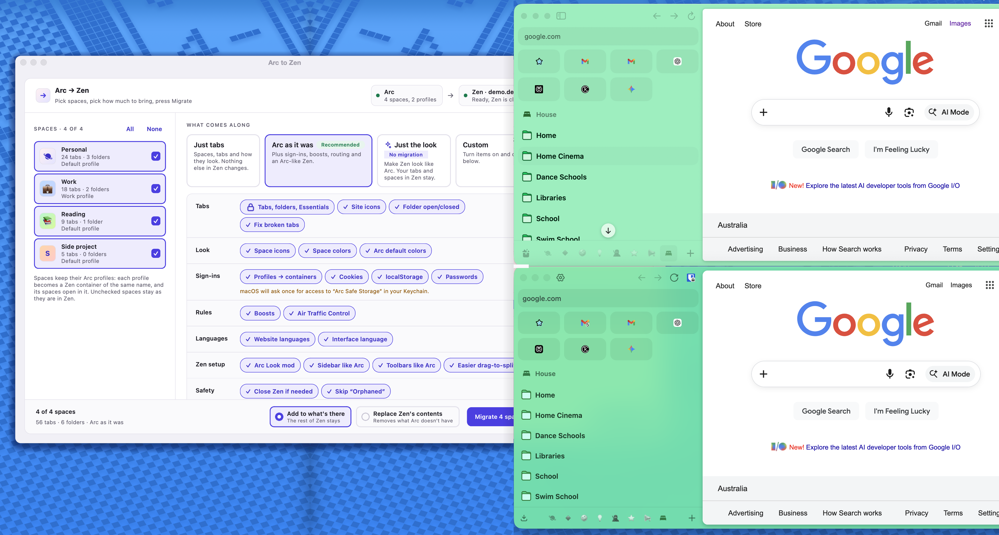

# Arc to Zen



Migrate all Arc workspaces data into Zen.

## Download

Download the latest desktop app from
[GitHub Releases](https://github.com/Thinkscape/arc-to-zen/releases/latest).

Pick the archive for your OS:

- macOS Apple Silicon: `macos-arm64`
- macOS Intel: `macos-x64`
- Windows: `windows-x64`
- Linux: `linux-x64`

## Migrates

- 🧭 Arc spaces to Zen workspaces
- 📌 pinned tabs and Essentials
- 🕘 temporary open tabs
- 🗂️ nested pinned folders
- 👁️ pinned-folder open/closed state
- 🎨 workspace icons and colors/themes
- 🌐 cached favicons
- 🧳 Arc profiles as Zen containers, each migrated workspace opening in its
  profile's container
- 🍪 optionally, cookies of those profiles, so sites stay signed in (macOS)
- 🔑 optionally, saved passwords of those profiles (macOS)
- 🚀 Arc boosts as Zen boosts (CSS per site)
- 🗄️ optionally, sites' localStorage of those profiles, in their containers

## GUI

1. Close Arc and Zen.
2. Open the downloaded app.
3. Choose the Arc data folder and target Zen profile.
4. In **Spaces**, uncheck the Arc spaces you do not want to migrate.
5. Choose what to migrate.
6. Use **Options** to skip the synthetic `Orphaned` workspace, create backups,
   and let the app close Zen automatically. Only the Zen running the target
   profile is closed; Zen windows of other profiles keep running.
7. Optionally enable **Clear out Zen profile before migration** to rebuild Zen
   from Arc.
8. Start the migration and wait for the progress log to finish.
9. Open Zen.

When only some spaces are selected, the migration replaces just the Zen
workspaces with the same names and keeps every other workspace, so spaces can
be migrated one at a time.

## macOS Unsigned App

The macOS build is not signed yet, so Gatekeeper may block it the first time.


1. Unzip the macOS download.
2. Try to open `Arc to Zen.app` once.
3. When macOS blocks it, open **System Settings**.
4. Go to **Privacy & Security**.
5. Scroll to **Security** and click **Open Anyway** next to `Arc to Zen.app`.
6. Confirm with **Open Anyway** and enter your password or use Touch ID if asked.
7. Open `Arc to Zen.app` again.

## CLI

Install Python dependencies:

```bash
python3 -m venv .venv
. .venv/bin/activate
pip install -e .
```

Run the full migration:

```bash
python cli.py
```

Clean rebuild mode:

```bash
python cli.py --nuke
```

`--nuke` clears existing Zen tabs, folders, pins, groups, closed-tab state, and
regular bookmarks before importing Arc data, even when only some spaces are
selected. It also removes Zen workspaces that are not being migrated, such as
the default `Space` of a new profile, and containers no migrated Arc profile
uses, such as the built-in `Banking` and `Shopping`, together with their
cookies, site permissions, and site storage (localStorage, IndexedDB). Backups are created unless
`--no-backups` is used.

Useful switches:

- `--arc-profile PATH`
- `--zen-profile PATH`
- `--list-spaces` prints the Arc space names
- `--space NAME` migrates only that space; repeat it to pick several. Other Zen
  workspaces are kept
- `--include-orphaned` creates a separate workspace for unmatched Essentials
- `--no-backups`
- `--no-favicons`
- `--no-folder-states`
- `--no-workspace-icons`
- `--no-workspace-themes`
- `--no-default-theme` keeps Zen's colors on spaces without an Arc theme; by
  default they get Arc's default gradient (`#fff1f2` → `#e3e3ff`)
- Arc internal pages open as their Zen counterparts (`arc://downloads` →
  `about:downloads`, `arc://settings` → `about:preferences`, `arc://extensions`
  → `about:addons`, passwords → `about:logins`). Other `arc://` pages,
  `chrome-extension://` pages, and `blob:` URLs cannot open in Zen and are
  skipped; the log lists them.
- `--no-tab-repair` keeps tab URLs Zen cannot parse; by default they become
  `about:blank`, because such a tab (for example a bad punycode host like
  `ww.xn--15-.example.org`) makes Zen's menus stop responding
- `--no-boosts` skips Arc boosts
- `--no-containers` keeps workspaces and tabs out of per-profile containers
- `--cookies` copies the cookies of the migrated spaces' Arc profiles into
  their containers
- `--passwords` copies the saved passwords of those profiles into Zen
- `--local-storage` copies sites' localStorage of those profiles into their
  containers
- `--nuke-only`

## Containers and Cookies

Every Arc profile behind a migrated space becomes a Zen container with the same
name as the Arc profile, so the unrenamed default profile becomes `Default`.
Other profiles that still have Chromium's generated name ("Person 2") are named
after their first space instead. Containers that already
exist are reused by name, including the built-in `Personal` and `Work`. Each migrated workspace gets that container as its
default, and its tabs and Essentials move into it.

Cookie migration is on by default in the GUI and opt-in in the CLI
(`--cookies`). It reads the Arc cookie key from the macOS
Keychain item `Arc Safe Storage`, so macOS asks for permission first. Only
persistent, unexpired, unpartitioned cookies are copied; existing Zen cookies
with the same name, host, path, and container are overwritten. Session cookies
are skipped. Arc on Windows is not supported yet.

## Passwords

Password migration is on by default in the GUI and opt-in in the CLI
(`--passwords`). It decrypts Arc's `Login Data` and `Login Data For Account`
with the same Keychain key as cookies (macOS asks once per run), then starts
Zen headless on the target profile for a few seconds so Zen encrypts the
logins with its own key. Passwords never touch the disk in plain text.

- Zen keeps passwords per profile, not per container, so logins of all selected
  Arc profiles end up in one password manager.
- Logins that already exist for the same site, auth kind, and username are
  skipped; "never save" entries and federated sign-ins are not copied.
- A Zen profile with a Primary Password is refused; remove it first.
- Set `ZEN_BINARY` if Zen is not installed in a standard location.

## localStorage

localStorage migration is on by default in the GUI and opt-in in the CLI
(`--local-storage`). It reads Arc's `Local Storage/leveldb` (a Chromium
LevelDB, parsed in pure Python) and writes the values through a headless Zen
into the container of each profile, so they land in Zen's own format.

- Only web sites (`http`/`https`) are copied; extension storage is skipped.
- Keys a site already has in Zen are kept, not overwritten.
- Values over Zen's per-site quota (5 MB) are skipped and counted in the log.
- IndexedDB and Session Storage are not migrated: converting Chromium's
  IndexedDB format is fragile, and sites re-download that data themselves.

## Boosts

Arc keeps boosts in its account data; the migration reads the local Firestore
cache in `~/Library/Application Support/firestore/Arc` (next to the Arc data
folder) and adds each boost to Zen for the same host, with its CSS, name, and
zap selectors. Boosts belong to the Arc account, so all of them are copied
regardless of the selected spaces. A boost active in Arc becomes the active Zen
boost for its site unless Zen already has one active there. Zen boosts have no
JavaScript, so a boost's JS is not copied; the log names those boosts.
Re-running updates the same boosts instead of duplicating them.

## Profiles

The GUI auto-detects common Arc and Zen profile locations. You can also browse
to them manually.

Common roots:

- Arc macOS: `~/Library/Application Support/Arc`
- Arc Windows: `%LOCALAPPDATA%\Packages\TheBrowserCompany.Arc_*\LocalCache\Local\Arc`
- Zen macOS: `~/Library/Application Support/zen`
- Zen Windows: `%APPDATA%\zen`
- Zen Linux: `~/.zen` or the Zen Flatpak profile directory

Zen profile resolution uses explicit selection first, then `ZEN_PROFILE_PATH`,
`ZEN_PROFILE_NAME`, Zen defaults from `installs.ini` / `profiles.ini`, and
finally the first profile containing `zen-sessions.jsonlz4`.

Arc desktop Linux is not auto-detected because Arc desktop is currently known
for macOS and Windows only.

## Build

Build a native package for the current OS:

```bash
pip install -e ".[build]"
python scripts/build_desktop.py --version dev
```

Release builds are created by GitHub Actions when a `v*` tag is pushed.
